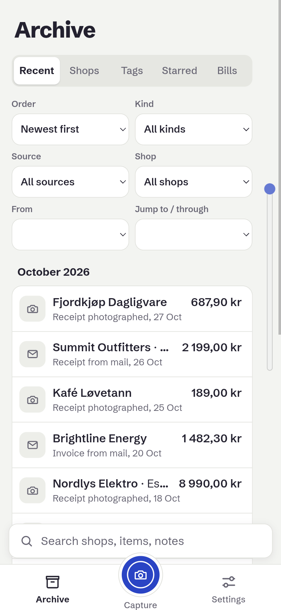
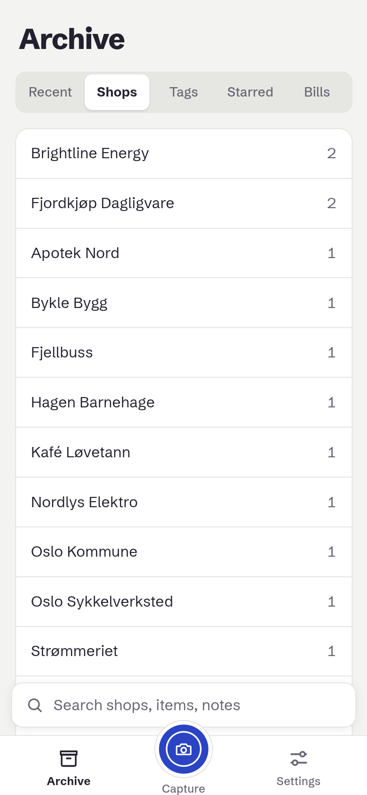
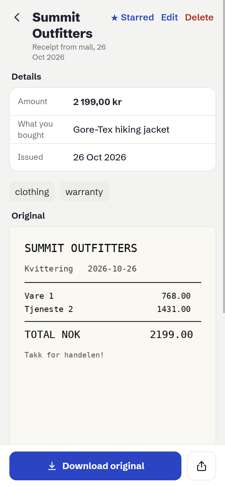
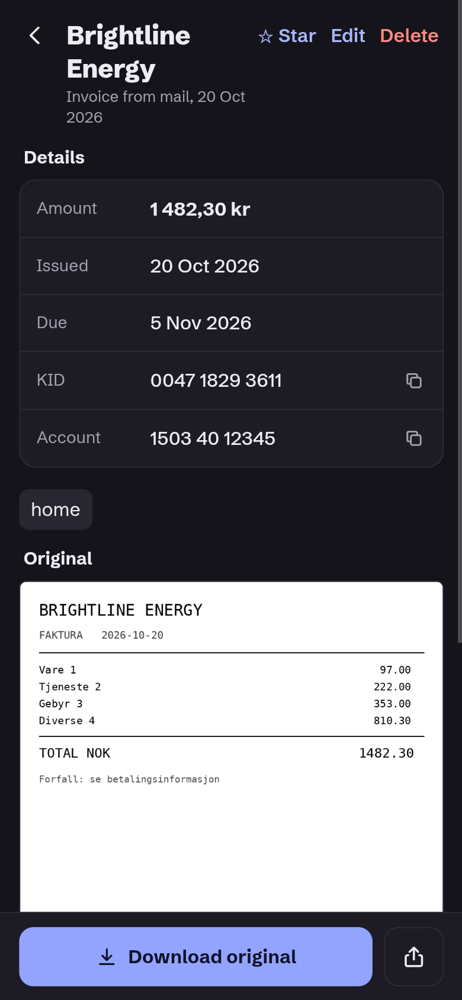

# Moneta

Receipts and invoices in one archive: collected from maily, captured with the phone camera.

<table>
  <tr>
    <td align="center"></td>
    <td align="center"></td>
    <td align="center"></td>
    <td align="center"></td>
  </tr>
  <tr>
    <td align="center"><sub>Archive</sub></td>
    <td align="center"><sub>Shops</sub></td>
    <td align="center"><sub>Receipt with original</sub></td>
    <td align="center"><sub>Invoice (dark mode)</sub></td>
  </tr>
</table>

<sub>Screenshots: Moneta 0.1.0 (commit <code>c8645e5</code>), taken 28 October 2026 with sample data.</sub>

## Development

```sh
nvm use            # Node 22+ locally; images run Node 24
npm install
cp .env.example .env
npm run dev        # tsc watch · backend http://localhost:3047 · web http://localhost:5173
npm run gate       # format → lint → build → typecheck → test (+ docker build if packaging changed)
```

## Layout

- `packages/core`: shared domain types and logic
- `apps/web`: React + Vite web app
- `backend`: Fastify API; serves the built web app in production

## Deployment

Pushing to `main` builds the image on Forgejo Actions, pushes it to `git.gjessing.io/gjessing1/moneta-backend`
and redeploys it on the host. Health check: `GET /api/health`.
